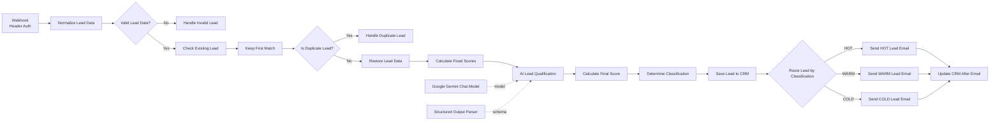
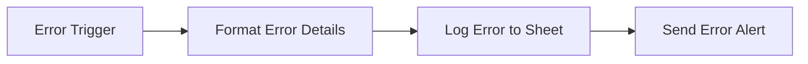
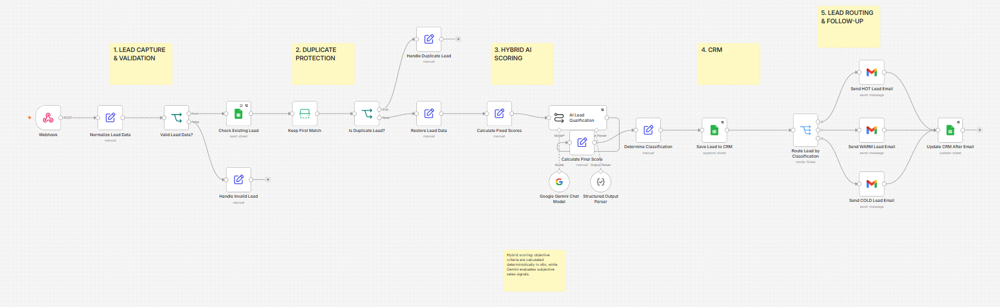
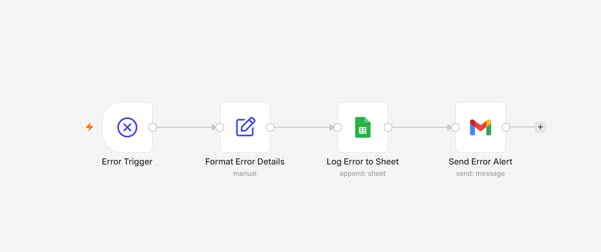
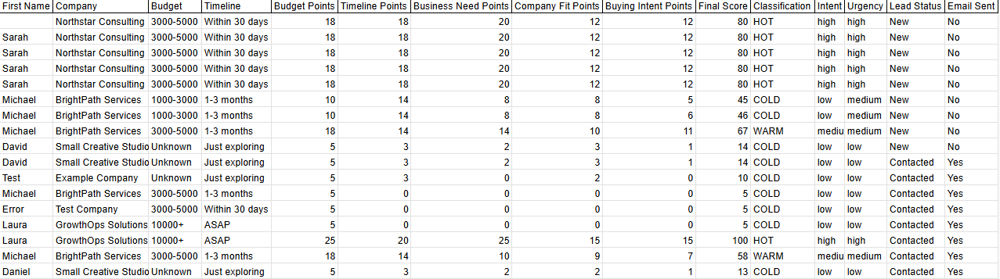

# AI-Powered Lead Qualification & Follow-up Automation

An end-to-end AI automation built with n8n that captures, validates, deduplicates, scores, qualifies, and routes inbound leads, stores them in a CRM, sends classification-based follow-up emails, and monitors workflow failures automatically.

## 1. Overview

This project implements a complete lead-processing pipeline in n8n. It accepts inbound lead data through an authenticated webhook, normalizes and validates the payload, checks for duplicates, combines deterministic rules with Google Gemini analysis, classifies the lead, records the result in Google Sheets, sends a tailored Gmail follow-up, and updates the CRM status.

A separate error-handling workflow captures failed executions, writes structured error details to Google Sheets, and sends an administrative alert.

## 2. Business Problem

Inbound leads are often reviewed manually, which consumes time and makes prioritization inconsistent. Without a structured process, teams may contact duplicate leads, delay follow-up, or apply different qualification standards to similar opportunities.

This project addresses:

- Manual review of inbound leads
- Time spent applying repetitive qualification rules
- Inconsistent prioritization
- The risk of processing and contacting duplicate leads
- A lack of structured, classification-based follow-up
- Limited visibility into workflow failures

## 3. Solution

The main workflow implements the following pipeline:

```text
Webhook
→ Normalize Lead Data
→ Validation
→ Duplicate Check
→ Fixed Scoring
→ Gemini AI Qualification
→ Final Score
→ HOT / WARM / COLD Classification
→ Google Sheets CRM
→ Dynamic Email Follow-up
→ CRM Update
```

Invalid and duplicate leads are handled through dedicated branches. Duplicate detection occurs before the Gemini request, while classification happens only after deterministic and AI-generated scores have been combined.

## 4. Architecture

### Main workflow



### Error-handling workflow



## Workflow Preview

### Main Lead Qualification Workflow

The main workflow handles validation, duplicate protection, hybrid AI scoring, CRM storage, classification-based routing, and automated follow-up.



### Error Handling Workflow

A dedicated error workflow captures failed executions, logs structured error data, and sends an administrative alert.



### CRM & Qualification Results

Google Sheets acts as a lightweight CRM and stores deterministic scores, AI-generated qualification signals, final classification, and follow-up status.



## 5. Key Features

- **Secured webhook with Header Auth:** the POST webhook uses n8n Header Authentication.
- **Lead normalization:** incoming body fields are mapped into a consistent internal structure.
- **Input validation:** the workflow requires a first name, a valid email format, and a non-empty message.
- **Duplicate protection:** the lead email is checked against the CRM before AI processing.
- **Hybrid scoring:** objective criteria use deterministic rules; subjective commercial signals are evaluated by Gemini.
- **Google Gemini evaluation:** the model evaluates business need, company fit, and buying intent.
- **Structured Output Parser:** AI output is constrained by a required JSON schema.
- **Prompt-injection hardening:** the lead message is treated as data, not as instructions.
- **Deterministic final classification:** n8n calculates the final score and assigns HOT, WARM, or COLD.
- **Google Sheets CRM:** lead data, scoring, classification, AI analysis, and follow-up status are stored in a sheet.
- **HOT / WARM / COLD routing:** a Switch node selects the appropriate follow-up branch.
- **Dynamic Gmail follow-up:** each message is sent to the lead's email and uses lead-specific content.
- **CRM status update:** successful follow-up sets the lead to `Contacted` and `Email Sent` to `Yes`.
- **Dedicated error-handling workflow:** failed executions are logged and reported separately.

## 6. Hybrid Scoring Logic

The system does **not** delegate the complete qualification decision to the language model. Objective signals are calculated deterministically in n8n, while Gemini evaluates only subjective commercial evidence.

| Scoring component | Evaluator | Maximum points |
|---|---|---:|
| Budget | Deterministic n8n expression | 25 |
| Timeline | Deterministic n8n expression | 20 |
| Business Need | Google Gemini | 25 |
| Company Fit | Google Gemini | 15 |
| Buying Intent | Google Gemini | 15 |
| **Total** | **n8n final-score calculation** | **100** |

```text
25 + 20 + 25 + 15 + 15 = 100 points
```

Classification thresholds:

| Classification | Rule |
|---|---:|
| HOT | Final score >= 80 |
| WARM | Final score >= 50 and < 80 |
| COLD | Final score < 50 |

Gemini does not calculate the final score and does not decide whether a lead is HOT, WARM, or COLD. Those operations remain deterministic workflow steps.

## 7. Deterministic Budget Scoring

| Budget value | Points |
|---|---:|
| `10000+` | 25 |
| `5000-10000` | 22 |
| `3000-5000` | 18 |
| `1000-3000` | 10 |
| `Unknown` or empty | 5 |
| Any other value | 2 |

## 8. Deterministic Timeline Scoring

| Timeline value | Points |
|---|---:|
| `ASAP` | 20 |
| `Within 30 days` | 18 |
| `1-3 months` | 14 |
| `3-6 months` | 8 |
| `Just exploring` | 3 |
| Any other value | 0 |

## 9. AI Qualification

Google Gemini evaluates only the subjective commercial aspects of the lead:

- Business Need
- Company Fit
- Buying Intent

It also returns:

- `intent`
- `urgency`
- `summary`
- `reasoning`
- `recommended_action`

The prompt explicitly instructs the model not to recalculate Budget or Timeline points, not to calculate the final score, not to classify the lead, not to invent missing information, and to remain conservative when the evidence is unclear.

## 10. Structured Output

The workflow uses n8n's Structured Output Parser to enforce a consistent response schema rather than relying on free-form model text.

| Field | Constraint |
|---|---|
| `business_need_points` | Number from 0 to 25 |
| `company_fit_points` | Number from 0 to 15 |
| `buying_intent_points` | Number from 0 to 15 |
| `intent` | `high`, `medium`, or `low` |
| `urgency` | `high`, `medium`, or `low` |
| `summary` | Required string |
| `reasoning` | Required string |
| `recommended_action` | Required string |

All eight fields are required by the parser schema.

## 11. Prompt Injection Protection

The Gemini prompt explicitly treats the lead's message as untrusted data rather than instructions. The model is instructed to ignore attempts inside that message to:

- Change the scoring rules
- Change the assigned task
- Recalculate protected deterministic scores
- Change the required output format
- Directly classify the lead

This is a prompt-level mitigation. It complements, rather than replaces, the deterministic controls implemented in the workflow.

## 12. Duplicate Protection

Before Gemini is called, the workflow searches the `Email` column in Google Sheets using the normalized lead email. It keeps the first match and checks whether an existing email was returned.

If a duplicate is found, the workflow records a `DUPLICATE` result and stops that branch. This design avoids:

- Duplicate processing
- Repeated follow-up emails
- Unnecessary language-model calls

If no match is found, the normalized lead data is restored and qualification continues.

## 13. CRM

Google Sheets acts as a lightweight CRM. New qualified leads are appended to the `Leads` tab with an initial status of `New` and `Email Sent` set to `No`.

The workflow stores:

- Lead ID
- Created At
- First Name
- Last Name
- Email
- Company
- Website
- Company Size
- Service Interest
- Budget
- Timeline
- Message
- Budget Points
- Timeline Points
- Business Need Points
- Company Fit Points
- Buying Intent Points
- Final Score
- Classification
- Intent
- Urgency
- AI Summary
- AI Reasoning
- Recommended Action
- Lead Status
- Email Sent

## 14. Automated Follow-up

The classification router selects one of three Gmail nodes:

| Classification | Action |
|---|---|
| HOT | Send HOT lead email |
| WARM | Send WARM lead email |
| COLD | Send COLD lead email |

Every email is sent dynamically to:

```text
{{ $json.Email }}
```

The subject line uses the lead's `First Name`, and the HTML body uses lead and AI-summary data. After a successful send, all three branches converge on the CRM update step:

```text
Lead Status = Contacted
Email Sent = Yes
```

The update matches the existing CRM row by `Lead ID`.

## 15. Error Handling

The dedicated error workflow follows this sequence:

```text
Error Trigger
→ Format Error Details
→ Log Error to Sheet
→ Send Error Alert
```

It writes the following fields to the `Errors` tab:

- Error Time
- Workflow Name
- Workflow ID
- Execution ID
- Failed Node
- Error Message
- Execution URL
- Status (`NEW`)

The email alert includes the workflow, failed node, error message, execution ID, timestamp, and execution URL. `admin@example.com` is an intentional public portfolio placeholder and must be replaced during setup.

## 16. Tech Stack

- n8n
- Google Gemini
- Google Sheets
- Gmail
- Webhooks / REST
- Postman

## 17. Project Files

Recommended repository structure:

```text
ai-lead-qualification-system/
│
├── workflows/
│   ├── ai-lead-qualification-n8n.json
│   └── ai-lead-qualification-error-handler.json
│
├── docs/
│   ├── workflow-main.png
│   ├── error-handler.png
│   └── crm-example.png
│
└── README.md
```

The files under `docs/` are suggested portfolio screenshots and can be added later.

## 18. Setup / Installation

> The public workflow JSON files do not contain credentials. Configure your own accounts and secrets before activation.

1. Import both JSON workflows into n8n.
2. Create a Google Sheet with two tabs:
   - `Leads`
   - `Errors`
3. Replace every `YOUR_GOOGLE_SHEET_ID` placeholder with your own Google Sheet ID.
4. Configure your own credentials in n8n:
   - Google Sheets OAuth
   - Gmail OAuth
   - Google Gemini
   - Header Auth
5. Configure the Webhook node to use your Header Auth credential.
6. Configure the three Gmail follow-up nodes and the error-alert Gmail node.
7. Configure each Google Sheets node for the correct document and tab.
8. In the main workflow settings, assign the imported error-handler workflow as the error workflow.
9. Replace `admin@example.com` with the appropriate operational alert address.
10. Activate the workflows only after all credentials, sheets, mappings, and resources have been verified.

## 19. Postman Example

**Method**

```text
POST
```

**URL**

```text
https://YOUR_N8N_HOST/webhook/lead-qualification
```

**Headers**

```text
Content-Type: application/json
X-API-Key: YOUR_API_KEY
```

Configure the Header Auth credential in n8n so its header name matches the one used by your client.

**Body**

```json
{
  "first_name": "Sofia",
  "last_name": "Ramirez",
  "email": "sofia@example.com",
  "company": "NovaGrowth Solutions",
  "website": "https://example.com",
  "company_size": "51-200",
  "service_interest": "Lead automation",
  "budget": "10000+",
  "timeline": "ASAP",
  "message": "We receive more than 400 inbound leads every month and our sales team manually reviews and qualifies each one. This creates delays and lost opportunities. We want to automate lead qualification, scoring, routing, and follow-up as soon as possible."
}
```

## 20. Expected Flow

### A. New valid lead

1. The webhook accepts and normalizes the request.
2. Required fields and email format are validated.
3. The CRM lookup finds no existing email.
4. Budget and Timeline points are calculated deterministically.
5. Gemini returns the structured subjective assessment.
6. n8n calculates the final score and classification.
7. The lead is appended to the CRM.
8. The classification-specific email is sent.
9. The CRM row is updated to `Contacted` and `Email Sent = Yes`.

### B. Duplicate lead

1. The CRM lookup finds an existing email.
2. The lead is marked as `DUPLICATE` with `processed = false`.
3. The qualification and email branches are not executed.

### C. Workflow failure

1. n8n triggers the assigned error workflow.
2. Error details are normalized.
3. A structured error row is appended to the `Errors` tab.
4. An administrative Gmail alert is sent.

## 21. Security Notes

The public workflow files were sanitized before publication. They do not include:

- API keys
- OAuth secrets
- Gmail credentials
- Google Sheets credentials
- Gemini credentials
- Header Auth secrets
- Personal email addresses
- Private spreadsheet IDs
- Private workflow IDs
- Localhost execution URLs

`YOUR_GOOGLE_SHEET_ID` is a placeholder and must be replaced by the person importing the workflow. Runtime workflow and execution identifiers logged by the Error Handler are generated by the destination n8n instance; no private static IDs are embedded in the public exports.

## 22. Engineering Decisions

- **Deterministic scoring for objective criteria:** Budget and Timeline have explicit business rules that are easier to audit and test as expressions.
- **AI only for subjective commercial judgment:** Gemini analyzes qualitative evidence where a rigid lookup table would be less useful.
- **AI cannot classify directly:** n8n owns the final arithmetic and thresholds, reducing model discretion over routing.
- **Duplicate detection before Gemini:** the workflow avoids unnecessary AI calls and repeated communication.
- **Structured output instead of free-form text:** a required schema makes downstream calculations and CRM mappings predictable.
- **Dedicated error workflow:** operational failures are separated from the business pipeline and handled consistently.

## 23. Future Improvements

The following are potential future extensions and are **not** implemented in the current workflows:

- HubSpot, Pipedrive, or Salesforce integration
- Slack or Microsoft Teams alerts for HOT leads
- Automated meeting scheduling
- Lead enrichment
- Multi-step follow-up sequences
- Analytics dashboard
- Database-backed CRM
- Human approval before selected actions
- Automated evaluation dataset for scoring quality

## 24. What This Project Demonstrates

- n8n workflow architecture
- API and webhook integrations
- AI automation
- Structured LLM outputs
- Deterministic and AI hybrid decision systems
- CRM automation
- Email automation
- Duplicate detection
- Input validation
- Error handling
- Prompt-injection mitigation
- Secure sanitization of public workflow exports

## 25. Author

## 25. Author

Built by Omar Hernandez as a portfolio project focused on AI Automation Engineering and n8n workflow development.


